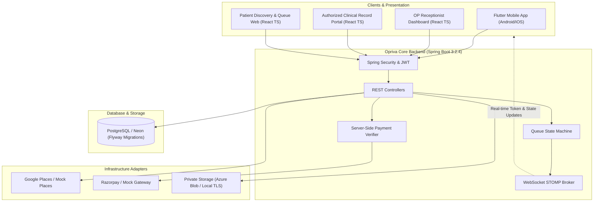

# Opriva — Healthcare, Without the Wait.

**Opriva** is a production-oriented healthcare platform for Outpatient (OP) hospital discovery, card registration (Normal vs. Special), real-time queue management, verified digital receipts, and secure, consent-governed medical records.


---

## 1. System Architecture



---

## 2. Key Modules & Technology Stack

| Component | Technology | Description |
|-----------|------------|-------------|
| **Backend** | Java 17, Spring Boot 3.2.4, Spring Security, Hibernate | Stateless JWT authentication, role-based access control, Flyway migrations, Bean Validation, OpenAPI docs. |
| **Real-time Messaging** | Spring WebSocket + STOMP | Instant push updates on token states (`WAITING`, `CALLED`, `IN_CONSULTATION`, `COMPLETED`, `MISSED`, `CANCELLED`). |
| **Database** | PostgreSQL / Neon | 19 relational tables, foreign key constraints, unique indexing for tokens and idempotency keys. |
| **Web Portal** | React 18, TypeScript, Vite, Tailwind CSS | Multi-role dashboard (Patient, OP Receptionist, Clinical Record) with full 12 Indian language support and RTL. |
| **Mobile App** | Flutter 3, Dart, Material 3 | Patient discovery, live token tracking, and 12-language localization. |
| **Brand Assets** | High-Res PNG & Vector Icons | Custom symbol logo + separated wordmark "Opriva" with tagline *"Healthcare, Without the Wait."* |

---

## 3. Multilingual Support (12 Indian Languages)

Opriva natively supports:
1. **English** (Default)
2. **తెలుగు (Telugu)**
3. **हिन्दी (Hindi)**
4. **বাংলা (Bengali)**
5. **मराठी (Marathi)**
6. **தமிழ் (Tamil)**
7. **اردو (Urdu)** — *with native Right-to-Left (RTL) layout*
8. **ગુજરાતી (Gujarati)**
9. **ಕನ್ನಡ (Kannada)**
10. **മലയാളം (Malayalam)**
11. **ଓଡ଼ିଆ (Odia)**
12. **ਪੰਜਾਬੀ (Punjabi)**

---

## 4. Pre-Seeded Demonstration Credentials

| Role | Username | Password | Permitted Functions |
|------|----------|----------|---------------------|
| **OP Receptionist** | `receptionist@apollo.opriva.com` | `password123` | Queue management, Call Next, Walk-in registration, counters, receipts. |
| **Authorized Clinician** | `dr.sharma@apollo.opriva.com` | `password123` | Authorized patient lookup, consent-based report viewer, SHA-256 signed digital prescriptions. |
| **Patient** | `patient@opriva.com` | `password123` | Hospital discovery, Normal/Special card selection, payment verification, live queue tracking, medical document upload. |
| **Platform Support** | `support@opriva.com` | `password123` | Hospital verification audit, platform health, integration monitoring. |

---

## 5. Quick Start Instructions

### Prerequisites
- Java 17 JDK (verified at `C:\Program Files\Eclipse Adoptium\jdk-17.0.15.6-hotspot\`)
- Node.js (v18+) & npm

### Starting the Backend
Double-click `run-backend.bat` or run:
```powershell
cd c:\Opriva\opriva-backend
..\.tools\apache-maven-3.9.6\bin\mvn.cmd spring-boot:run
```
The API server starts at `http://localhost:8080`.
- Swagger UI / OpenAPI docs: `http://localhost:8080/swagger-ui.html`
- Health check: `http://localhost:8080/actuator/health`

### Starting the Web Portal
Double-click `run-web.bat` or run:
```powershell
cd c:\Opriva\opriva-web
npm run dev
```
Open your browser at `http://localhost:5173`.

### Running Automated Test Suite
```powershell
cd c:\Opriva\opriva-backend
..\.tools\apache-maven-3.9.6\bin\mvn.cmd test
```
All 5 comprehensive test suites verify:
- Security & JWT stateless authorization
- Medical document privacy & traversal protection
- Payment idempotency & server-side verification
- Queue token generation & state machine transitions

---

## 6. Scope Boundaries & Compliance
- **Not a Hospital Management System:** Opriva does not handle doctor scheduling, staff payroll, or internal hospital ERP operations.
- **Queue & Official ID Separation:** Application-generated token numbers (`N-101`, `S-201`) and OP registration IDs (`OPR-YYYYMMDD-XXXX`) are strictly separated from hospital-issued internal IDs.
- **Cryptographic Signatures:** Prescriptions issued via the clinical interface are signed with SHA-256 hashes for non-repudiation.
